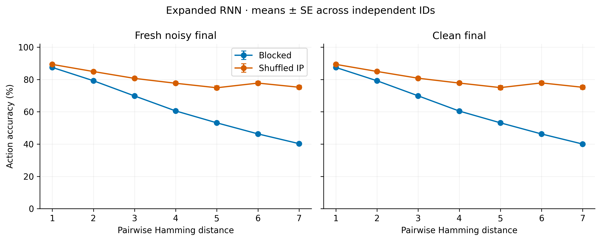

<div align="center">

<h1>CruxRNN</h1>
<p><strong>Exploring how sequence similarity shapes learning, memory, and interference in recurrent neural networks.</strong></p>
<a href="https://github.com/ericqin0816/crux-rnn/actions/workflows/ci.yml"></a>


<a href="LICENSE"></a>
<p><a href="README.md">English</a> · <a href="README.zh-CN.md">简体中文</a></p>
</div>

**v2 review candidate.** The upgrade is on a separate branch; v1.0 remains
preserved. Merge and final v2 release await owner review.

CruxRNN is an independent computational replication and controlled extension
of [Song, Kim & Kim (2026)](https://doi.org/10.1038/s41598-026-40162-w).
It asks how similarity between seven-action patterns changes the relative
effects of concentrated blocked practice and shuffled interleaved practice.
Climbing motivated the question; these are artificial-network simulations,
with no human participants or climbing measurements.



## Measured results

**100 pairs at each k=1–7: 1400 main schedule models.** Smaller matched
extensions bring the completed scientific total to **2760 main models**;
D-adapted clones are counted separately. No v1, smoke or pilot data are pooled.
The original-distance primary endpoint is fresh-noisy action accuracy before D:

| k | Pairs | Blocked % | IP % | IP−blocked pp | CI low | CI high |
| --- | --- | --- | --- | --- | --- | --- |
| 1 | 100 | 87.448 | 89.304 | 1.857 | 0.651 | 2.976 |
| 2 | 100 | 79.203 | 84.897 | 5.693 | 4.050 | 7.377 |
| 4 | 100 | 60.508 | 77.634 | 17.126 | 15.023 | 19.283 |
| 7 | 100 | 40.249 | 75.170 | 34.921 | 32.358 | 37.524 |

All seven pointwise intervals exclude zero. Primary distance tests passing Holm correction: 1, 2, 4, 7. Original-four slope: 5.600 pp per Hamming unit, 95% CI [5.131, 6.058], Holm p=0.0005999.
IP has lower mean exact-sequence accuracy at k=3,4,5,6,7, despite any action-accuracy advantage. Statistics concern this model/generator, not human mechanisms.
See the [full report](reports/v2_research_report.md) for all seven conditions,
secondary outcomes, adjusted tests, effect sizes and sensitivity analyses.

## Quick start

Use an activated virtual environment; the tiny demo runs on CPU and is not a
scientific result. [Installation and exact versions](docs/reproducibility.md).

```bash
git clone https://github.com/ericqin0816/crux-rnn.git
cd crux-rnn
git switch v2-research-upgrade
python -m pip install -e ".[dev]"
python -m unittest discover -s tests -p "test_v2*.py" -v
cruxrnn demo --output outputs/my-demo
```

The v2 suite supports modern PyTorch. The complete historical test suite and
bitwise research reproduction use the separately documented Python 3.8.10 /
PyTorch 1.13.1 CPU environment. Both CI jobs pass on their stated environments.

## Method and extensions

Within each pair, weights and noisy examples are identical; only presentation
order changes. All three pairwise sequence distances equal k. Pretrain once,
then train each schedule for 750 SGD updates and test on independently noisy
held-out cues. Copies and action positions are not independent subjects.

- RNN / GRU / LSTM, with parameter counts and approximate matching.
- Fully blocked, 1000/100-example blocks, trial cycling and shuffled IP.
- RNN capacities h=7,16,32,64; fresh cue-noise robustness.
- A/B/C learning dynamics, exact-sequence scores and matched D interference.

[Methods](docs/methodology.md) · [Experiments](docs/experiments.md) ·
[Statistical plan](docs/statistical_analysis.md) · [Code audit](docs/code_audit.md)

## Explore and reproduce

Download the repository and open [docs/demo/index.html](docs/demo/index.html).
The self-contained viewer needs no server or frontend install. It separates
illustrative schedules from actual results; unmeasured conditions stay missing.
No site or final v2 release is deployed before review.

```bash
cruxrnn run --config configs/v2/main.json --workers 4
cruxrnn verify --config configs/v2/main.json
cruxrnn analyze --config configs/v2/main.json
cruxrnn figures --config configs/v2/main.json
```

[Download compact seed-level data](https://raw.githubusercontent.com/ericqin0816/crux-rnn/v2-research-upgrade/results/v2/run_level.csv)
· [Tables, figures and checksum indexes](results/v2/)
· [Owner study guide](docs/researcher_guide.md)
· [Preserved v1 release and raw archive](https://github.com/ericqin0816/crux-rnn/releases/tag/v1.0-final-experiment)

Full v2 checkpoints/arrays are supplied as a local archive with an integrity
receipt, pending an owner-approved release. They are excluded from Git.
Measured scientific execution: 1637.45 seconds (27.29 minutes),
excluding analysis/figure/report preparation. See provenance for exact times.

## Repository

```text
src/cruxrnn/          typed v2 models, data, schedules, training, statistics, CLI
src/motor_rnn/        frozen v1 numerical implementation
configs/v2/          committed main, pilot and smoke recipes
results/v2/          actual seed-level results, figures and provenance
tests/               historical and expanded scientific controls
docs/                methods, statistics, reproduction and owner guide
docs/demo/           offline interactive HTML/SVG results explorer
reports/             separate v1 and v2 research reports
```

## Limits and acknowledgment

The full cue contains its targets. Ordinal labels, unmatched action
frequencies/repeats, fixed budgets, observed D distances and sign-flip
assumptions limit generality. Equal-budget architecture comparisons do not
estimate each architecture's optimized potential. No biological mechanism or
climbing-performance effect is demonstrated. [Full limitations](docs/limitations.md).

Read [CITATION.cff](CITATION.cff), acknowledge the source paper and
[pinned source repository](https://github.com/YJ-0000/RNN_during_RP_and_IP),
and cite the exact version used. The proposed MIT scope covers independently
authored CruxRNN code/assets; third-party rights remain separate in
[NOTICE.md](NOTICE.md). Development was AI-assisted and requires independent
owner review. [Contributing](CONTRIBUTING.md) · [Changelog](CHANGELOG.md) ·
[Original v1 overview](README.v1.md).
