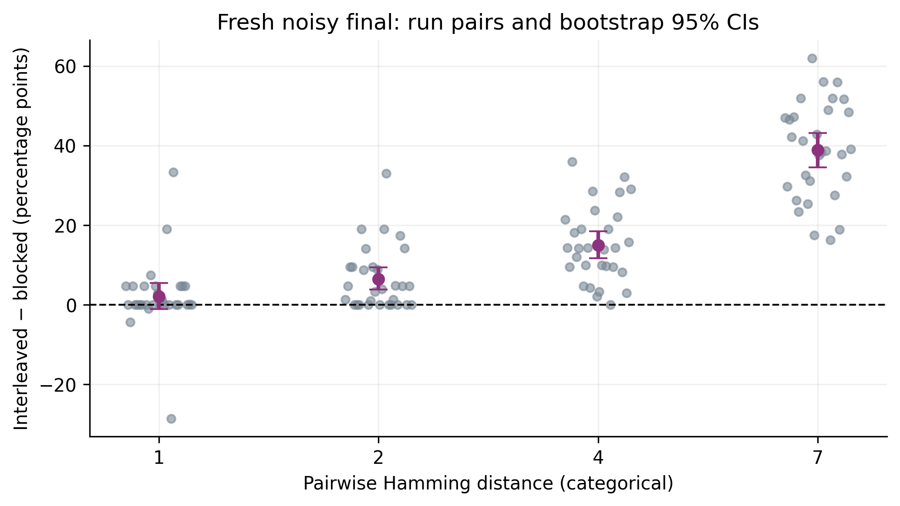

# CruxRNN

**Sequence Similarity, Practice Scheduling, and Interference in a Minimal Recurrent Neural Network**

CruxRNN is a computational replication and controlled extension of Song, Kim, and Kim (2026). It tests whether similarity between seven-action sequences changes the relative effects of blocked and interleaved practice in a small Elman recurrent neural network.

The project was motivated by questions about repetition, route similarity, and motor learning in speed climbing, but all experiments are synthetic neural-network simulations and do not use human participants or biological recordings.

**Current status: approved confirmatory final experiment complete.** All 120 fresh paired cells / 240 main models are verified, with zero failures or exclusions. Source reproduction (100 pairs), smoke (4) and pilot (20) remain separate. The earlier 120-pair exploratory study has incomplete producing-SHA/timestamp provenance and is excluded from these final results; [prior execution](reports/prior_execution.md) discloses that history.

Start with [RUN_REPORT.md](RUN_REPORT.md), the [student notebook](notebooks/walkthrough.ipynb), and [confirmatory results](reports/results.md). Code, tables, figures and provenance are published in [ericqin0816/crux-rnn](https://github.com/ericqin0816/crux-rnn). Release tag: `v1.0-final-experiment`.

## 1. Research question

How does sequence similarity change learning and interference under blocked versus interleaved practice in this minimal recurrent network?

## 2. Motivation

Climbing supplies an analogy for repeating or alternating movement patterns. It supplies no measurements, biological evidence, or tested climbing-performance effects. The study asks a narrow computational question.

## 3. Original paper

Song, Youngjo; Kim, Hakjoo; Kim, Taewon. [“A minimal recurrent neural network models the robustness of interleaved practice on motor sequence learning.”](https://doi.org/10.1038/s41598-026-40162-w) *Scientific Reports* 16, 10068 (2026). DOI: 10.1038/s41598-026-40162-w.

## 4. Original repository and inspected commit

[YJ-0000/RNN_during_RP_and_IP](https://github.com/YJ-0000/RNN_during_RP_and_IP), exact commit `31f58bb6de90d1fffcb752c0b97afb7df51479a7`. The audit checkout is only in ignored `external/author_repo/`. No root LICENSE was found; author code and figures are not copied into CruxRNN. Model behavior is independently implemented.

## 5. Source audit

[Audit](reports/audit.md): Figure 2 says 10,000 pretraining trials versus Methods/code 1,000; uniqueness is not enforced; retention reuses training inputs; vulnerability uses only the last sequence; run-level random streams are unsaved; one learning-curve CI uses the wrong sample-count axis; and “epochs” denote batch updates. Source-exact mode retains these experimental limitations.

## 6. Experimental design

Pretrain once per run×distance on ten bases ×100 noisy copies. Clone into paired schedules with identical state hashes and fresh SGD. A/B/C each have 5000 training examples (750 total updates). Fixed development probes evaluate all three at updates 0,25,…,750. Separate clean/noisy held-out probes, 100 unseen unique bases, and paired D training complete each controlled cell. [Methods](reports/methods.md).

## 7. Model architecture

One tanh `torch.nn.RNN`: 7 input / 7 hidden units. Linear readout produces 4 logits; a second linear map feeds raw logits back to 7 inputs. The complete `(batch,1,7)` cue yields `(batch,7,4)` outputs, with hidden reset per example. Eight recurrent calls preserve the final unused source transition. Cross-entropy; SGD .02; zero momentum; batch size 20.

## 8. Sequence-similarity manipulation

At k=1,2,4,7 exactly k positions differ, with distinct A/B/C actions at changed positions and identical actions elsewhere. All pairwise Hamming distances must equal k. Labels are 0–3; cues are base+1 with Gaussian SD .1 input noise. Controlled base sets are unique and disjoint. Frequencies/repeated-action patterns are recorded but not matched.

## 9. Blocked versus interleaved conditions

Schedules use the same master noisy examples, targets, starting weights, SGD settings, exposures, and update counts. Blocked presents whole sequence blocks; interleaved permutes identical IDs. The frozen final assignment gives each of the six block orders five repeats per distance. Paired cloned models learn identical D examples/order for 100 updates.

## 10. Repository structure

```text
src/motor_rnn/        independent numerical implementation
tests/               standard-library unittest controls
scripts/             execution, analysis, plotting, reporting
configs/             source/smoke/pilot and frozen final configurations
envs/                exact environment targets and setup evidence
results/             tracked source/smoke/pilot/final CSVs, figures, manifests
provenance/          environment, phase/hash indexes, approval gate
reports/             audit, methods, deviations, review and prior history
notebooks/           saved-data student walkthrough
outputs/             ignored full arrays and checkpoints
external/author_repo/ ignored pinned reference checkout
```

## 11. Environment setup

Python 3.8.10; PyTorch 1.13.1 CPU; NumPy 1.24.3; pandas 2.0.3; SciPy 1.10.1; Matplotlib 3.7.2; scikit-learn 1.3.0; joblib 1.4.2. Exact principal versions were achieved here. Conda was unavailable, so a local Windows runtime/pip supplied the same versions. [Deviations](reports/deviations.md); full freeze/system information in `provenance/environment/`.

Conda: `conda env create -f envs/reproduction.yml`, activate `motor-rnn-reproduction`, then substitute `python` below. Windows alternative:

```powershell
./scripts/setup_windows.ps1
$taskPython = Join-Path (Get-Location) 'envs/tools/python3810/tools/python.exe'
& $taskPython scripts/system_info.py
```

## 12. Running tests

```powershell
& $taskPython -m unittest discover -s tests -v
```

Final suite: 17 passed, zero failed/skipped: 14 scientific controls plus three approval/provenance checks. [Complete log](reports/unit_tests_confirmatory_final.txt). A public clone without the ignored author checkout skips the audit-only source-model parity test.

## 13. Running reproduction

Commit the code/configuration before a new phase. If needed, clone the reference into the ignored path and checkout the exact commit above.

```powershell
& $taskPython scripts/run_experiment.py --config configs/source_exact.json --limit 5 --resume
& $taskPython scripts/compare_source.py --limit 5 --label first_five
```

The five-run audit and later 100-run main reproduction already exist locally; resume verifies/skips completed cells. A fresh source-only checkout regenerates them. Exact historical author seeds are unavailable. Optional source vulnerability and Figure 2 sensitivity configurations are unexecuted.

## 14. Running smoke test

```powershell
& $taskPython scripts/run_experiment.py --config configs/smoke.json --resume
& $taskPython scripts/analyze.py --config configs/smoke.json
```

One reduced-budget ID exercises all four distances and every pipeline stage, including D, saved outputs, analysis, and figures. Smoke has no scientific interpretation.

## 15. Running pilot

```powershell
& $taskPython scripts/run_experiment.py --config configs/pilot.json --resume
& $taskPython scripts/analyze.py --config configs/pilot.json
& $taskPython scripts/verify_design.py --config configs/pilot.json
```

Five namespace-separated IDs × four distances yield 20 paired cells / 40 main schedule models. Scientific settings were not changed to favor outcomes. [Raw metrics](results/pilot/raw_metrics.csv), [run-level metrics](results/pilot/run_level.csv), [diagnostic summary](results/pilot/primary_summary.csv), [timings](results/pilot/execution_times.csv).

## 16. Running the final experiment

The user approved the fresh confirmation after pilot review. Frozen config: `configs/final_proposed.json`, SHA-256 `26f8cc56ad115f9e4bb4bb47b30af4997c205cd2906cb8e5195bf24fda8ff006`; namespace `cruxrnn_final_proposed_v1`. Completed 30 IDs at each k=1,2,4,7, with five instances of each blocked order per k. Pre-final Git checkpoint `fa3b7c34496274569944b85c74d2c6c4cd443fe4` was pushed before execution; producing commit `28a2b07bb40afcf7af9b907612e01ce722902bcc` has byte-identical numerical modules. [Approval](provenance/final_approval.json) and [execution records](results/confirmatory/execution_records/) record the relationship.

```powershell
& $taskPython scripts/run_experiment.py --config configs/final_proposed.json --resume
& $taskPython scripts/analyze.py --config configs/final_proposed.json
& $taskPython scripts/verify_design.py --config configs/final_proposed.json
& $taskPython scripts/publish_confirmatory.py
& $taskPython scripts/create_walkthrough.py
```

Start from a clean Git tree; the runner verifies existing complete cells and only continues incomplete work. A fresh checkout regenerates all cells from the frozen seeds. [Prior execution disclosure](reports/prior_execution.md) distinguishes the earlier exploratory study.

## 17. Results

Fresh-noisy final action accuracy, before D; differences/intervals are percentage points:

| k | pairs | Blocked % | IP % | Mean IP−blocked pp | Median pp | SD pp | 95% CI low pp | 95% CI high pp |
| --- | --- | --- | --- | --- | --- | --- | --- | --- |
| 1 | 30 | 89.002 | 91.116 | 2.114 | 0.000 | 9.097 | -1.086 | 5.437 |
| 2 | 30 | 80.221 | 86.651 | 6.430 | 4.357 | 7.930 | 3.878 | 9.418 |
| 4 | 30 | 61.006 | 76.019 | 15.013 | 14.238 | 9.451 | 11.722 | 18.459 |
| 7 | 30 | 40.163 | 79.029 | 38.865 | 38.905 | 12.254 | 34.549 | 43.122 |

The intervals include zero at k=1; the direction at these distances remains uncertain. The categorical mean differences increase across the four distances. The prespecified slope is **6.124 pp per Hamming unit**, with a run-ID bootstrap 95% CI **[5.383, 6.853]**.

[Full results](reports/results.md) include clean/complete-sequence/CE/A-B-C/position/generalization/speed/D outcomes. [Every individual pair](results/confirmatory/paired_differences.csv) is retained. Source, smoke, pilot and earlier exploratory data were not pooled. Measured final phase runtime: 381.342 seconds (6.36 minutes); zero failures/exclusions.

## 18. Figures

Five original figures use only the new confirmation: learning curves, final accuracy, paired differences with bootstrap CIs, D forgetting, and shared/differing position errors. All export 300-dpi PNG plus PDF in [results/confirmatory/figures](results/confirmatory/figures/). Clean/noisy panels are separate; k=7 shared positions have NaN/count zero. `scripts/analyze.py` regenerates them. Pilot/smoke figures retain diagnostic labels in their separate directories.



## 19. Limitations

The full cue contains the targets, making this numeric decoding rather than unseen-movement prediction or biological consolidation. Fixed architecture/budget, unmatched action frequencies/repeats, and ordinal cues limit generality. Copies/positions are not independent subjects; D similarity is observed. Original exploratory/source/smoke/pilot pre-execution Git/timestamp records are missing; the new confirmation records them contemporaneously. Prior exploratory outcomes were seen, so this run is a disclosed independent confirmation, not a retroactively untouched preregistration.

## 20. Reproducibility

Git/code snapshot → config → named BLAKE2b seeds → data/manifest hashes → checkpoints → metrics → analysis → figures → report. Historical producing Git SHAs were not recorded; later snapshot/reverification commits are honestly labeled in `provenance/stages.json`. Future runs require a clean committed tree and record producing SHA, environment/config fingerprints, UTC times, failures/successes, and artifact hashes. Ignored raw arrays/checkpoints are indexed in `results/*/artifact_index.json`. GitHub is a transparency record, not automatic scientific validation.

The existing local folder remains `proj1`; the project/repository/distribution is CruxRNN / `crux-rnn`. [GitHub delivery](docs/github_setup.md). No Git LFS is required. Full raw confirmation arrays/checkpoints are supplied as `cruxrnn-confirmatory-data.zip` with a SHA-256/CRC record in `artifacts/confirmatory_archive.json`; extract at the release checkout root. The release provides this asset separately from Git history. Historical outputs stay separate.

## 21. Citation / acknowledgments

Cite the original paper and pinned repository above. CruxRNN independently reproduces the specified behavior and adds controlled data/evaluation, without broad novelty claims. Climbing is motivation only. [Professor questions](reports/professor_questions.md) support discussion of interpretation and follow-up work.
