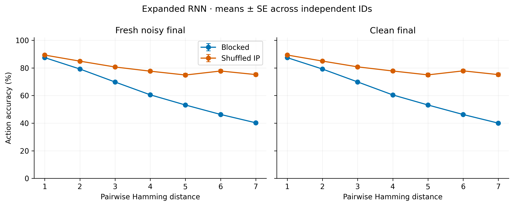

<div align="center">

<h1>CruxRNN</h1>
<p><strong>探索序列相似性如何塑造循环神经网络中的学习、记忆与干扰。</strong></p>
<a href="https://github.com/ericqin0816/crux-rnn/actions/workflows/ci.yml"></a>


<a href="LICENSE"></a>
<p><a href="README.md">English</a> · <a href="README.zh-CN.md">简体中文</a></p>
</div>

**v2 审阅候选版。** 升级位于独立分支，v1.0 保持可访问；合并与正式发布 v2 均须等待项目所有者审阅。

CruxRNN 是对 [Song、Kim 和 Kim（2026）](https://doi.org/10.1038/s41598-026-40162-w)
的独立计算复现与受控扩展。研究问题是：七个动作组成的序列越相似或越不相似，
集中练习与交错练习对循环神经网络的影响有何变化？攀岩中的重复动作与相近路线
启发了这个问题，但本项目没有人类被试、脑部记录或攀岩测量数据。



## 实测结果

**k=1–7 每个条件完成 100 次配对，共 1400 个主实验模型。** 加上使用较小样本的
配对扩展，科学实验共完成 **2760 个主训练模型**；学习 D 后的模型副本另行计数。
v1、冒烟测试和试运行的数据均未并入最终推断。原始四个距离条件的主要指标是
学习 D 之前、加入独立新噪声的最终动作准确率：

| 汉明距离 k | 配对次数 | 集中练习 % | 交错练习 % | 平均差值（百分点） | 区间下限 | 区间上限 |
| --- | --- | --- | --- | --- | --- | --- |
| 1 | 100 | 87.448 | 89.304 | 1.857 | 0.651 | 2.976 |
| 2 | 100 | 79.203 | 84.897 | 5.693 | 4.050 | 7.377 |
| 4 | 100 | 60.508 | 77.634 | 17.126 | 15.023 | 19.283 |
| 7 | 100 | 40.249 | 75.170 | 34.921 | 32.358 | 37.524 |

七个条件的逐点区间均不包含零；逐点区间不等同于多重比较校正后的结论。 原始距离条件中，通过 Holm 校正的检验为：1、2、4、7。
原始四个距离的斜率为每单位汉明距离 5.600 个百分点，
95% 区间 [5.131, 6.058]，Holm 校正 p=0.0005999。
在 k=3、4、5、6、7 时，交错练习的平均完整序列准确率更低，因此动作准确率的优势不能概括为所有指标都更好。 统计结论只针对本模型与数据生成规则，不代表人类神经机制。
全部七个条件、次要指标、效应量、校正检验与敏感性分析见[完整报告](reports/v2_research_report.md)。

## 快速开始

先激活独立 Python 虚拟环境。轻量演示使用 CPU，不能当作科学结论。
详细安装步骤与精确版本见[复现指南](docs/reproducibility.md)。

```bash
git clone https://github.com/ericqin0816/crux-rnn.git
cd crux-rnn
git switch v2-research-upgrade
python -m pip install -e ".[dev]"
python -m unittest discover -s tests -p "test_v2*.py" -v
cruxrnn demo --output outputs/my-demo
```

v2 测试支持较新的 PyTorch。完整历史测试与逐位数值复现使用单独记录的
Python 3.8.10 / PyTorch 1.13.1 CPU 环境。两个 CI 任务均在各自声明的环境中通过。

## 方法与扩展

每次配对中，模型初始权重和含噪训练样本完全相同，主要操纵变量是呈现顺序。
A、B、C 三对序列的汉明距离均等于 k。每个单元只预训练一次，各练习条件完成
750 次 SGD 更新，随后用独立噪声的保留数据评估。含噪副本与动作位置不算独立样本。

- 比较 RNN、GRU 与 LSTM，报告参数量，并提供近似参数匹配。
- 比较集中练习、每 1000/100 个样本交替、逐试次循环与随机交错练习。
- 检查 h=7、16、32、64 的模型容量，以及新输入噪声下的稳健性。
- 记录 A/B/C 学习过程、完整序列准确率，以及学习相同 D 序列后的干扰。

[方法](docs/methodology.md) · [实验](docs/experiments.md) ·
[统计方案](docs/statistical_analysis.md) · [代码审计](docs/code_audit.md)

## 交互查看与复现

下载仓库后打开 [docs/demo/index.html](docs/demo/index.html)。这个独立 HTML 页面
不需要服务器或前端依赖；练习顺序示意图与实测结果明确分开，未测条件不会编造数值。
审阅前不部署网站，也不发布正式 v2 版本。

```bash
cruxrnn run --config configs/v2/main.json --workers 4
cruxrnn verify --config configs/v2/main.json
cruxrnn analyze --config configs/v2/main.json
cruxrnn figures --config configs/v2/main.json
```

[下载精简的逐次结果数据](https://raw.githubusercontent.com/ericqin0816/crux-rnn/v2-research-upgrade/results/v2/run_level.csv)
· [表格、图与校验索引](results/v2/)
· [项目所有者学习指南](docs/researcher_guide.md)
· [保留的 v1 版本与原始数据包](https://github.com/ericqin0816/crux-rnn/releases/tag/v1.0-final-experiment)

v2 的完整权重与数组以附有完整性记录的本地数据包交付，等待所有者批准发布；
这些大文件不进入 Git。科学实验实测运行时间为 1637.45 秒（27.29 分钟），
不含统计分析、制图与报告整理；精确时间见运行溯源记录。

## 仓库结构

```text
src/cruxrnn/          带类型标注的 v2 模型、数据、练习顺序、训练、统计与命令行
src/motor_rnn/        冻结的 v1 数值实现
configs/v2/          已提交的主实验、试运行与冒烟测试配置
results/v2/          逐次实测结果、图与溯源记录
tests/               历史与扩展科学验证测试
docs/                方法、统计、复现与所有者指南
docs/demo/           离线交互式 HTML/SVG 结果查看器
reports/             独立的 v1 与 v2 研究报告
```

## 局限与致谢

初始提示包含全部目标，因而这是完整提示的数值解码任务。动作的序数编码、未匹配的
动作频率与重复模式、固定训练预算、未操纵的 D 距离，以及符号翻转检验的假设，
均限制结论的适用范围。相同预算下的架构比较不代表各架构经过充分调参后的上限。
本项目不能证明人脑机制或攀岩表现的改善。[完整局限](docs/limitations.md)。

引用时请使用 [CITATION.cff](CITATION.cff)，注明实际使用版本，并致谢原论文及
[固定提交的原始仓库](https://github.com/YJ-0000/RNN_during_RP_and_IP)。拟采用的 MIT
许可仅覆盖独立编写的 CruxRNN 代码与原创视觉素材；第三方权利范围见
[NOTICE.md](NOTICE.md)。开发与文档使用了 AI 辅助，须由项目所有者独立审阅。
[贡献指南](CONTRIBUTING.md) · [更新记录](CHANGELOG.md) · [v1 原始说明](README.v1.md)。
